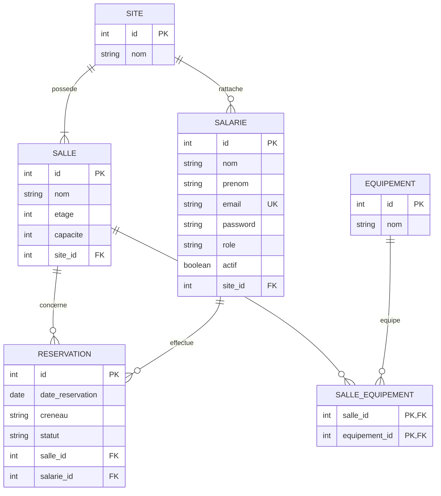

# Réservation de salles

<p align="center">
  <strong>Application web de gestion et de réservation de salles de réunion</strong>
  <br>
  Projet de développement | BTS SIO 2ème année
</p>

<p align="center">
  
  
  
  
</p>

---

## Présentation

**Réservation de salles** est une application web destinée à faciliter la gestion et la réservation de salles de réunion au sein d'une grande entreprise possédant plusieurs sites géographiques.

L'application centralise les informations relatives aux différents sites, aux salles disponibles et à leurs équipements. Elle permet aux salariés de rechercher une salle adaptée à leurs besoins, de consulter ses disponibilités et d'effectuer des réservations.

Un espace d'administration permet également de gérer les ressources de l'entreprise et les comptes utilisateurs.

Le projet est réalisé dans le cadre du **BTS Services Informatiques aux Organisations (SIO), option SLAM**, dans le cadre d'un exercice de développement applicatif.

## Fonctionnalités

### Espace salarié

- Authentification par identifiant et mot de passe.
- Consultation des différents sites de l'entreprise.
- Consultation des salles et de leurs caractéristiques.
- Recherche de salles selon différents critères.
- Consultation des équipements disponibles.
- Réservation d'une salle sur un créneau disponible.
- Modification de ses propres réservations.
- Annulation de ses réservations.
- Consultation des réservations à venir.
- Consultation de l'historique des réservations.
- Possibilité de réserver sur n'importe lequel des sites de l'entreprise.

### Espace administrateur

- Gestion des comptes salariés.
- Gestion des rôles et des accès.
- Gestion des sites.
- Gestion des salles de réunion.
- Gestion des équipements.
- Association des équipements aux salles.
- Consultation des réservations de l'ensemble des salariés.
- Gestion des réservations.

### Gestion des disponibilités

Le système de réservation repose sur des créneaux d'une demi-journée.

| Jour | Matin | Après-midi |
|---|:---:|:---:|
| Lundi | ✅ | ✅ |
| Mardi | ✅ | ✅ |
| Mercredi | ✅ | ✅ |
| Jeudi | ✅ | ✅ |
| Vendredi | ✅ | ✅ |
| Samedi | ✅ | ❌ |
| Dimanche | ❌ | ❌ |

Des règles de gestion empêchent :
- La réservation d'une salle déjà occupée sur le créneau choisi.
- La réservation de plusieurs salles par un même salarié sur un même créneau.
- La réservation en dehors des jours et horaires autorisés.

Les réservations passées sont conservées afin de permettre la consultation de l'historique.

---

## Sites de l'entreprise

L'entreprise dispose de huit sites géographiques :

| Site | Localisation |
|---|---|
| Limoges | France |
| Lagord | France |
| Malaunay | France |
| Sillé-le-Guillaume | France |
| Le Haillan | France |
| Nantes | France |
| Saint-Priest | France |
| Vezin-le-Coquet | France |

Chaque site dispose d'un bâtiment unique accueillant plusieurs salles de réunion.

Les salariés peuvent réserver une salle sur l'ensemble des sites, sans restriction liée à leur site de rattachement.

---

## Technologies utilisées

| Technologie | Utilisation |
|---|---|
| PHP | Langage backend |
| Symfony | Framework applicatif |
| Doctrine ORM | Mapping objet-relationnel |
| MySQL | Système de gestion de base de données |
| Twig | Moteur de templates |
| HTML5 | Structure des interfaces |
| CSS3 | Mise en forme |
| JavaScript | Interactions côté client |

**Architecture :** application Web accessible depuis l'intranet de l'entreprise, reposant sur une architecture Symfony et une base de données relationnelle.

---

## Modèle de données

La base de données repose sur six entités principales.

| Entité | Description |
|---|---|
| `Site` | Sites géographiques de l'entreprise |
| `Salle` | Salles de réunion et leurs caractéristiques |
| `Salarie` | Comptes utilisateurs et informations des salariés |
| `Equipement` | Référentiel des équipements disponibles |
| `Reservation` | Réservations effectuées par les salariés |
| `SalleEquipement` | Association entre les salles et les équipements |

### Relations principales

- Un site possède plusieurs salles.
- Un site accueille plusieurs salariés.
- Une salle appartient à un seul site.
- Un salarié est rattaché à un seul site.
- Une salle peut disposer de plusieurs équipements.
- Un équipement peut être associé à plusieurs salles.
- Une salle peut faire l'objet de plusieurs réservations.
- Un salarié peut effectuer plusieurs réservations.

### Diagramme conceptuel (MCD)



---

## Sécurité et gestion des accès

L'application prévoit deux rôles :

| Rôle | Permissions |
|---|---|
| `ROLE_SALARIE` | Consultation et gestion de ses propres réservations |
| `ROLE_ADMIN` | Accès aux fonctionnalités salariées et à l'administration |

Les mécanismes de sécurité prévus comprennent :

- Authentification avec Symfony Security.
- Hashage des mots de passe.
- Protection des routes selon les rôles.
- Vérification des droits sur les réservations.
- Protection CSRF des formulaires.
- Validation des données côté serveur.
- Contrôle des conflits de réservation.

---

## Structure du projet

Organisation du projet :

```text
reservation-de-salles/
│
├── LICENSE                 # License du projet
└── README.md               # Vous le lisez actuellement
```

*Cette arborescence pourra évoluer au cours du développement.*

---

## Documentation

La documentation technique du projet comprendra normalement :

- Cahier des charges.
- Modèle conceptuel des données (MCD).
- Modèle physique des données (MPD).
- Analyse du modèle objet.
- Description des règles de gestion.
- Documentation des entités Doctrine.
- Documentation des contrôleurs et templates Twig.

---

## Contexte pédagogique

Ce projet est réalisé dans le cadre du **BTS SIO**, spécialité **Solutions Logicielles et Applications Métiers (SLAM)**.

Il a pour objectif de mettre en pratique les compétences liées à :

- La conception et la modélisation de bases de données.
- Le développement d'applications Web.
- La programmation orientée objet.
- L'utilisation d'un framework PHP.
- La gestion des accès et de la sécurité.
- La mise en œuvre d'une architecture MVC.
- La gestion de projet et la documentation technique.

---

## Licence

Ce projet est distribué sous licence **MIT**.

Vous êtes libre de :
- Utiliser le code source.
- Copier et modifier le projet.
- Distribuer le projet et ses versions modifiées.
- Utiliser le projet à des fins personnelles ou commerciales.

La seule condition est de conserver la notice de copyright et le texte de la licence dans les copies ou distributions du projet.

Consultez le fichier [`LICENSE`](LICENSE) pour obtenir le texte complet de la licence.

Copyright (c) 2026 - Prysm228555

---

<p align="center">
  <strong>Développé avec 💜 par un humain.</strong>
  <br/>
  Ce README est la seule partie du projet réalisé à l'aide d'une IA générative.
  <br/>
  Ces IA ont également été utilisé à des fin d'information.
</p>
